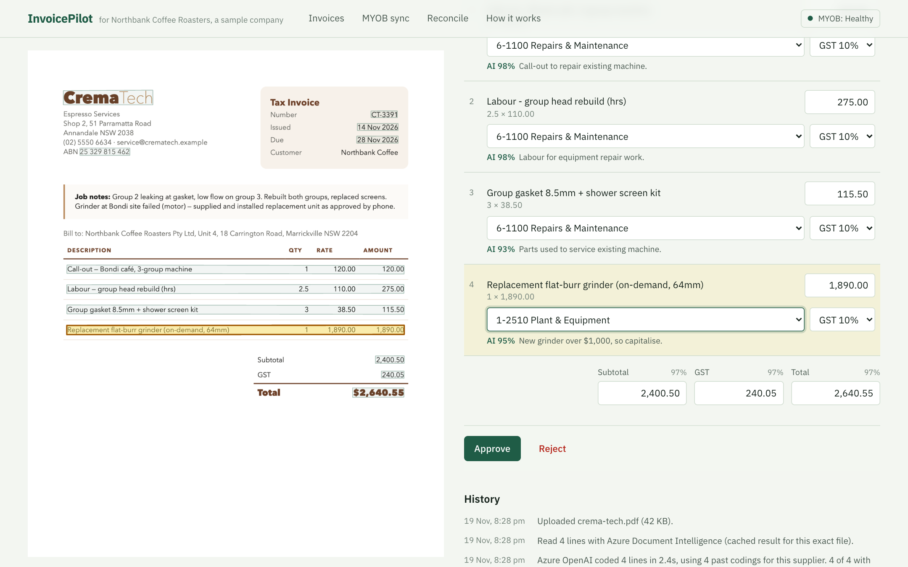
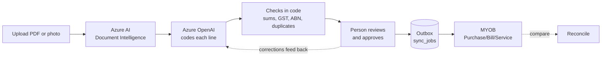

# InvoicePilot

Supplier invoices in, bills in MYOB out. InvoicePilot reads invoices with Azure AI Document Intelligence, suggests the account and GST code for every line with Azure OpenAI, puts each one in front of a person to check and approve, and posts approved bills to MYOB with retries that never pay a supplier twice.

**Live demo: https://ashy-tree-0d409aa00.4.azurestaticapps.net** (each visitor gets their own copy of a sample company)
**Walkthrough: [45-second video](https://github.com/TonyTech404/invoicepilot/releases/download/v1.0.0/invoicepilot-walkthrough.mp4)**, recorded on the live site



## Try it in five minutes

1. **Espresso machine repair** sample. Watch the AI put labour and parts in Repairs & Maintenance but capitalise the $1,890 grinder as Plant & Equipment, using how this supplier was coded before.
2. **Pallet freight** sample. The ABN fails its checksum (one digit is wrong), and the app says so before anyone pays it.
3. **Weekly milk delivery**, twice. The second upload is blocked as a duplicate.
4. **Crema Tech CT-3302** in the list. MYOB rejected it because a line used a closed account. Pick the account the AI suggested, approve, post.
5. **MYOB sync → Failure lab.** Set MYOB to *Dropping responses*, approve and post something: the bill is saved but the reply is lost, and the next attempt finds the bill instead of posting it again. Turn the duplicate guard off and do it again, then open **Reconcile** to see the duplicate bill it caught.

## What is real and what is simulated

| | |
|---|---|
| Reading invoices | Real. Azure AI Document Intelligence, prebuilt invoice model, free tier. |
| Coding lines to accounts | Real. Azure OpenAI (gpt-5.4-mini) with structured outputs. |
| Database, API, hosting | Real. Neon Postgres, Azure Functions, Azure Static Web Apps. |
| MYOB | Simulated. An in-process API that follows MYOB AccountRight's request and response shapes, including its failure modes. The client code takes a transport, so pointing it at `api.myob.com` is a configuration change, not a rewrite. |
| Suppliers and invoices | Made up. Phone numbers use the 02 5550 range reserved for fiction. |

## How it works



- **Reading and judging are separate.** Document Intelligence finds fields, line items and where each sits on the page (used to highlight the source of any field). The language model only decides accounts and GST codes. Either half can be swapped; replacing the coder with Claude touches one file.
- **The model suggests, a person decides.** Each line gets a confidence and a short reason. Reviewer corrections are stored next to the AI's original suggestion and fed back as examples for that supplier, so coding improves without retraining.
- **Arithmetic stays out of the prompt.** Totals, GST at 10%, the ABN checksum and duplicate detection are ordinary, unit-tested code ([`api/src/checks.ts`](api/src/checks.ts)).
- **Posting assumes the network lies.** Approved invoices go into an outbox. Rate limits (MYOB answers `403 Developer Over Qps`, not 429) back off and retry; validation errors stop for a person; timeouts are treated as "maybe it worked", so the next attempt looks the bill up before posting again. Details in [docs/myob-sync.md](docs/myob-sync.md).
- **Reconciliation, because sync drifts anyway.** People edit bills in MYOB, type some in by hand, and old scripts double-post. The reconcile screen lists all of it.

More in [docs/architecture.md](docs/architecture.md).

## Stack

| Layer | Choice |
|---|---|
| Web | React 19, TypeScript, Tailwind CSS 4, pdf.js, Vite |
| API | [Hono](https://hono.dev) on Azure Functions (Node), one HTTP function behind Static Web Apps |
| Data | Neon Postgres via postgres.js. Plain SQL migrations in [`db/migrations`](db/migrations) |
| AI | Azure AI Document Intelligence `prebuilt-invoice`, Azure OpenAI `gpt-5.4-mini` (Data Zone deployment) |
| Infrastructure | Bicep ([`infra/main.bicep`](infra/main.bicep)): Static Web App, Document Intelligence, Azure OpenAI, Application Insights, Log Analytics, budget alert |
| CI/CD | GitHub Actions: checks on every pull request, deploy on merge via OIDC (no Azure secrets stored), Bicep on infra changes, a 15-minute retry worker |

## Repository layout

```
api/            Hono API, Azure Functions entry, tests
  src/
    docintel.ts   Document Intelligence call and field mapping
    coding.ts     Azure OpenAI account coding (prompt + JSON schema)
    checks.ts     deterministic invoice checks
    invoices.ts   the pipeline: upload, extract, code, review, approve, post
    sync.ts       outbox worker: retries, backoff, look-before-repost
    reconcile.ts  app vs MYOB comparison
    myob/         MYOB client, simulated AccountRight API, transport
    seed/         per-visitor sample company (from real model output)
  test/           unit tests, plus an integration test against Postgres
web/            React app
shared/         types shared by API and web
db/migrations/  SQL migrations
infra/          Bicep
scripts/        sample invoice generator, migration runner
```

## Run it locally

You need Node 22+, a Postgres database (a free Neon project works), and an Azure Document Intelligence and Azure OpenAI resource (`infra/main.bicep` creates both).

```bash
cp .env.example .env        # fill in the values
npm install
npm run db:migrate
npm run dev                 # API on :7071, web on :5173
```

Tests:

```bash
npm test                                   # unit tests
DATABASE_URL=... npm test                  # plus the integration test against Postgres
```

Regenerate the sample invoices with `npm run samples` (renders HTML to PDF with Chrome).

## Deploy

```bash
az group create -n rg-invoicepilot -l australiaeast
az deployment group create -g rg-invoicepilot -f infra/main.bicep \
  -p databaseUrl="$DATABASE_URL" cronSecret="$CRON_SECRET" budgetEmail="you@example.com"
```

After that, merging to `main` deploys: the workflow logs in to Azure with OIDC, migrates the database, uploads the web app and API bundle to Static Web Apps, and waits for `/api/health` to report the new commit.

## Running costs

Document Intelligence runs on the free tier (500 pages a month), and results are cached by file hash, so a re-upload costs nothing. Coding one invoice uses about 1,500 tokens, a fraction of a cent. Static Web Apps (Free) and Neon (Free) cost nothing. Uploads are rate limited per visitor and per day, and an Azure budget alert emails at 80% of $5 a month.
