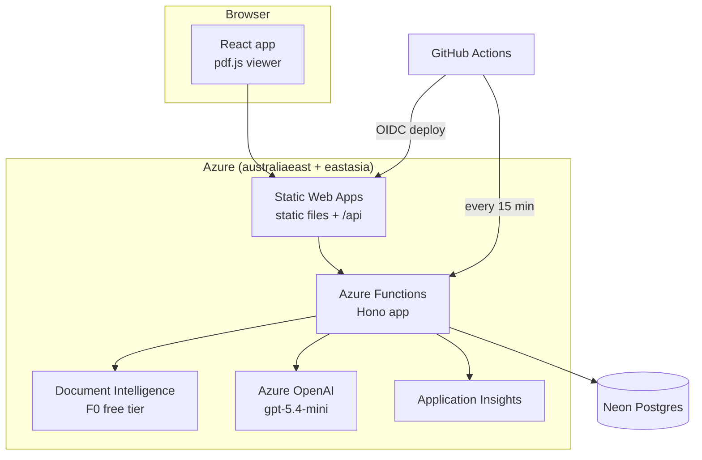

# Architecture

## Request flow for one invoice

| Step | Endpoint | What happens |
|---|---|---|
| Upload | `POST /api/invoices` | Type and size check, per-visitor rate limit, SHA-256 hash, file stored. Status `uploaded`. |
| Read | `POST /api/invoices/:id/extract` | Document Intelligence `prebuilt-invoice` (or the cached result for the same hash). Fields, lines, confidences and bounding polygons stored. Supplier matched by ABN, then by name. Status `extracted`. |
| Code | `POST /api/invoices/:id/code` | Azure OpenAI with the chart of accounts, bookkeeping rules and up to 30 past codings for the supplier. Strict JSON schema; account codes are an enum of active accounts, so the model cannot invent one. Status `needs_review`. |
| Review | `PATCH /api/invoices/:id` | Field and line edits. Checks recompute after every change. |
| Approve | `POST /api/invoices/:id/approve` | Refused while any check is an error. Creates the supplier if new. |
| Post | `POST /api/invoices/:id/post` | Queues a sync job and runs it inline for up to 12 s. See [myob-sync.md](myob-sync.md). |

The browser drives read and code as separate calls, so each step shows progress and a failure in one is retried on its own.

## Data model

- `workspaces`: one per visitor (cookie), each with its own mock MYOB company file. Pruned after 14 idle days.
- `invoices`, `invoice_lines`, `invoice_files`: the invoice, its lines (final account next to the AI's suggestion, confidence and reason), and the original file.
- `events`: an audit trail per invoice.
- `sync_jobs`, `sync_attempts`: the outbox and every call made to MYOB.
- `myob_suppliers`, `myob_bills`: the simulated MYOB company file.
- `accounts`, `tax_codes`: the chart of accounts with MYOB UIDs.
- `extraction_cache`, `rate_limits`: free-tier protection.

## Checks

All in `api/src/checks.ts`, unit-tested in `api/test/abn-and-checks.test.ts`:

| Check | Level |
|---|---|
| Supplier, invoice number, date or total missing | error |
| Lines do not add up to the subtotal | error |
| Subtotal plus GST is not the total | error |
| Same supplier and invoice number already in the system | error |
| A line uses a closed account, or has no account or tax code | error |
| ABN missing or fails the checksum | warning |
| GST differs from 10% of the GST-coded lines | warning |
| Due date before invoice date; invoice dated in the future | warning |
| The AI was unsure about a line (< 75%) and nobody has changed it | warning |
| A field or line was hard to read (< 80% / < 70%) | info |
| New supplier: will be created in MYOB on posting | info |

## Why these choices

- **Static Web Apps with managed Functions**: one free resource serves the app and the API on the same origin (no CORS, simple cookies), with GitHub-based deploys.
- **Hono**: the same app runs on Node locally and inside Azure Functions through a 30-line adapter (`api/src/functions.ts`), and its `fetch` interface is also how the mock MYOB is called in-process.
- **Neon**: serverless Postgres with branching. CI runs integration tests on a dedicated branch.
- **One esbuild bundle**: the deployed API is a single file with no `node_modules`, which keeps cold starts and deploys small.
- **Seed data from real model output**: `api/scripts/build-seed.ts` runs the actual pipeline over past invoices once, so the sample history shows genuine Document Intelligence and model results rather than invented numbers.
