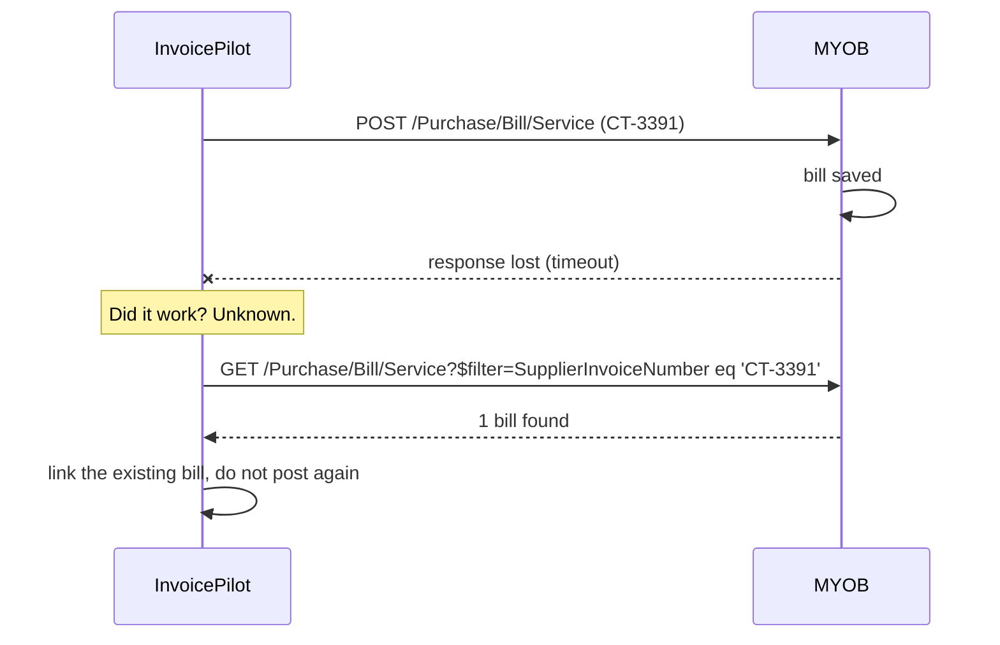

# Posting to MYOB without paying anyone twice

The hard part of an accounts payable integration is not the happy path. It is what happens when the accounting system is slow, rate limited, or saves your bill and then drops the connection before telling you.

## The failure that causes duplicate bills

A naive retry would `POST` again and create a second bill for the same supplier invoice. Nothing errors; the duplicate surfaces weeks later in a payment run. MYOB's API has no idempotency keys, so the client has to make retries safe itself.

## How the sync worker sorts failures

`api/src/sync.ts` keeps one row per invoice in `sync_jobs` (an outbox). A job is claimed with a 60-second lock, so two clicks or two workers never post the same invoice at once.

| What MYOB did | Kind | What the worker does |
|---|---|---|
| `201 Created` | success | Store the bill UID from the `Location` header, read the bill back, note any GST rounding difference |
| `403 Developer Over Qps`, `429` | rate limited | Nothing was written. Back off (500 ms, 1 s, 2 s… up to 8 s, with jitter) and retry |
| `503` | unavailable | Nothing was written. Back off and retry |
| timeout, other `5xx` | uncertain | The bill may exist. Mark the job `uncertain`; the next attempt searches MYOB by supplier invoice number before posting |
| `400` | validation | Retrying will not help (for example, a closed account). Fail the job and hand it back to a person with MYOB's message |

A request gets about 12 seconds of retries inline. After that the job is left as `retrying` with a `next_attempt_at`, and the scheduled worker (`.github/workflows/sync-worker.yml`, every 15 minutes) or the "Run due retries now" button picks it up. After six attempts it fails for good.

Supplier cards follow the same rule: look up by ABN before creating, so a retried `POST /Contact/Supplier` never makes two cards.

Note the rate-limit response: MYOB's API gateway answers with `403` and a "Developer Over Qps" message, not `429`. A client that treats every 403 as an auth failure gives up on a perfectly retryable request.

## Seeing it in the demo

The simulated MYOB (`api/src/myob/mock.ts`) has three modes, switched on the **MYOB sync** page:

- **Healthy**: every call works.
- **Flaky**: about 30% of calls get `403 Developer Over Qps` and 15% get `503`.
- **Dropping responses**: the first time a bill is created, it is saved and the response never arrives (`api/src/myob/transport.ts`).

The **duplicate guard** switch turns the look-before-repost step off. With the guard off and responses dropping, posting an invoice creates two bills, and the **Reconcile** page flags it.

`api/test/sync.int.test.ts` runs both cases against Postgres in CI.

## Reconciliation

Even a careful sync drifts from the books. `api/src/reconcile.ts` compares every bill the app posted with the bills in the MYOB company file and reports:

- **Duplicate in MYOB**: one supplier invoice, several bills (the seeded data includes one from an old import script).
- **Amount differs**: someone edited the bill in MYOB after posting. Gaps of a few cents are explained as MYOB's per-line GST rounding.
- **Missing from MYOB**: posted from here, deleted there.
- **Only in MYOB**: entered by hand, so it skipped review.

## Swapping in the real MYOB

`MyobClient` (`api/src/myob/client.ts`) takes a `transport: (Request) => Promise<Response>`. Today that transport calls the mock in-process. For production:

1. Use `fetch` as the transport and `https://api.myob.com/accountright/{companyFileId}` as the base URL.
2. Add OAuth 2.0: store the refresh token encrypted, refresh before expiry, and handle refresh-token rotation (a refresh that fails mid-rotation is its own uncertain case).
3. Map accounts, tax codes and suppliers to their MYOB UIDs once, then cache them.
4. Run the integration tests against a MYOB sandbox company file.
